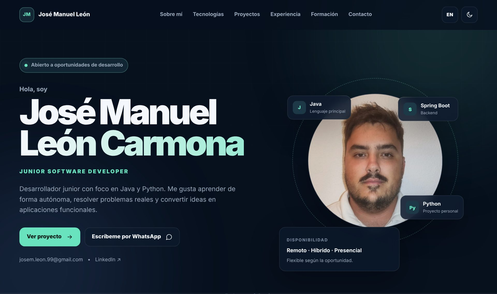

# José Manuel León Carmona · Junior Software Developer

Portfolio personal, bilingüe (español / inglés), publicado con GitHub Pages.

**🌐 [josemaleon.github.io](https://josemaleon.github.io/)**

[](https://josemaleon.github.io/)

## Sobre mí

Desarrollador junior con el título de **Técnico Superior en Desarrollo de Aplicaciones Multiplataforma (DAM)** y experiencia práctica en personalización de software empresarial. Trabajo principalmente con **Java** y **Python**.

- 💼 **Tier1 Technology:** prácticas como desarrollador junior sobre la plataforma Comerzzia (Java, Spring Boot, JPA/Hibernate, JavaScript, SQL).
- 🃏 **MagicInventory:** proyecto personal en desarrollo. Gestión de colecciones con Python, Firebase Authentication, Firestore e integración con la API de MKM para los precios.
- 🎓 DAM en Davante MEDAC (2023–2025) · AWS Cloud Quest: Cloud Practitioner · Inglés B2.

Abierto a oportunidades de desarrollo en remoto, híbrido o presencial.

## Contacto

- 📧 [josem.leon.99@gmail.com](mailto:josem.leon.99@gmail.com)
- 💼 [LinkedIn](https://www.linkedin.com/in/jmleoncarmona)
- 💬 WhatsApp: desde la sección de contacto del [portfolio](https://josemaleon.github.io/#contacto)

## Sobre esta web

Hecha a mano con **HTML, CSS y JavaScript**, sin frameworks ni dependencias.

- Español / inglés, con el idioma elegido guardado en el navegador.
- Tema oscuro / claro según la preferencia del sistema.
- Diseño adaptado a móvil, tablet y escritorio.
- Accesibilidad: enlace para saltar al contenido, navegación con teclado y animaciones reducidas si el sistema lo pide (`prefers-reduced-motion`).
- SEO básico: metadatos Open Graph, datos estructurados JSON-LD y página 404.

### Estructura

```text
├── index.html          # Contenido de la página
├── styles.css          # Estilos, temas y diseño adaptable
├── script.js           # Traducciones, tema, menú y animaciones
├── 404.html
├── favicon.svg
├── site.webmanifest
├── robots.txt
└── assets/images/      # Foto de perfil y captura de vista previa
```

### Ejecutarla en local

```bash
python -m http.server 8000
```

Después abre `http://localhost:8000`.

### Notas de mantenimiento

- Los textos están en `index.html` (español) y en el objeto `translations` de `script.js` (español e inglés). Al cambiar un texto hay que actualizar ambos.
- El número de WhatsApp está en `whatsappNumber` (`script.js`) y en los enlaces `wa.me` de `index.html`.
- Al cambiar `styles.css` o `script.js`, sube el parámetro de versión (`?v=...`) en `index.html` para que los navegadores no usen la versión guardada en caché.
